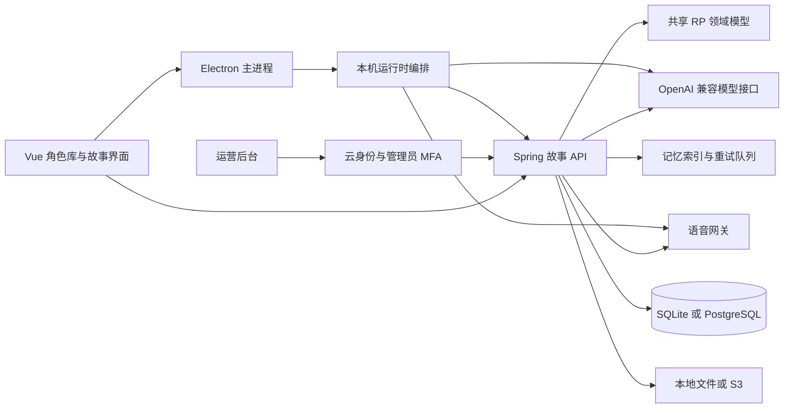
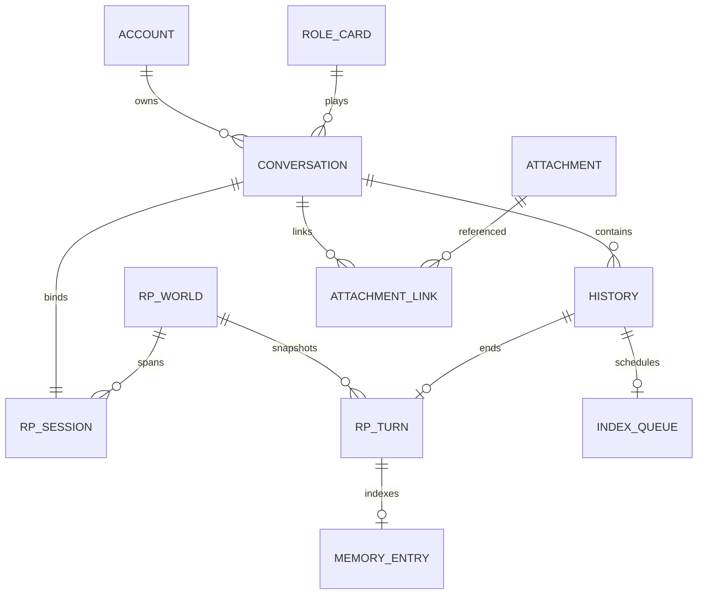
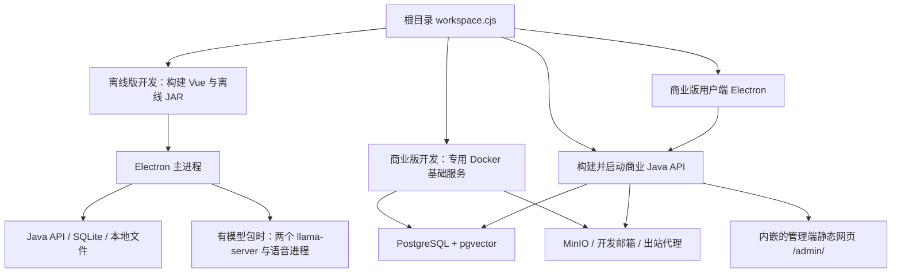

# 项目架构

## 产品与发行边界

项目只有商业版与离线版。商业版包含桌面用户端、浏览器管理端，以及二者共用的商业后端；离线版为一个整体。代码标识 `cloud` = 商业版，`offline` = 离线版，`admin` = 商业版管理端前端目标。商业版负责账号、托管数据、模型代理与运营；离线版由 Electron 编排本机 API、聊天/嵌入模型与语音服务，默认无需账号服务器和网络。

图中的云身份和运营只存在于商业服务端；离线发行 profile 排除云 Java 类、云配置、PostgreSQL 迁移和管理站点。桌面商业包只包含界面与受控 IPC，没有数据库服务或模型权重。

## 模块职责

| 路径 | 职责与入口 |
| --- | --- |
| `apps/desktop/electron/release-main.cjs` | 窗口、受限 app 协议、CSP、系统加密凭据与 IPC |
| `apps/desktop/electron/offline-runner.cjs` | 随机本机端口、进程生命周期、模型健康检查、模型包切换 |
| `apps/desktop/src/release/ReleaseApp.vue` | 角色库、账号/本地设置、篇章与聊天协调 |
| `apps/desktop/src/release/AdminApp.vue` | 用户、用量、故障和审计展示 |
| `apps/server/src/main/java/.../release/` | 业务 API、所有权检查、模型连接、语音、附件、索引与迁移 |
| `apps/server/src/main/java/.../release/cloud/` | 商业账号、邮件、管理员、S3 与 BYOK |
| `apps/server/voice/server.py` | ONNX ASR/TTS 与受限音频解码 |
| `packages/rp/src/main/java/.../rp/` | 场景、世界线、回合快照、分支、回退与私有状态解析 |
| `external/` | 参考源码镜像；不进入应用、Docker 或开源导出 |

桌面工程只有一个 npm 依赖清单与锁文件。`src/package.json` 仅声明 ES module 边界，不需要独立安装依赖。三种 Vite mode 是 `cloud`、`offline`、`admin`，构建结果互相独立。

## 数据模型

- **篇章**：会话和消息分页的单位。
- **世界线**：场景、关系、事件和约定的权威状态；续章可以共用世界。
- **回合**：保存可见用户/角色原文、状态快照、完成状态、图片引用和收藏。
- **分支**：复制截至所选消息的上下文，生成独立世界，不改变原故事。
- **回退**：在原世界删除该节点之后的相关数据，恢复快照并清理派生索引。
- **记忆**：从已完成回合生成的可重建派生数据。召回始终按世界过滤，并再次核实原回合仍存在。

## 部署与选型

| 层 | 商业版 | 离线版 |
| --- | --- | --- |
| SQL / 向量 | PostgreSQL + pgvector，按世界精确检索 | SQLite WAL；BLOB 向量余弦检索与 FTS5 trigram |
| 对象 | S3 兼容存储，Compose 使用 MinIO | 数据目录中的文件 |
| 聊天 | 平台或按账号加密的 BYOK | Qwen3-4B 或用户显式设置的 API |
| 嵌入 / 语音 | 服务端平台配置；桌面经商业 API 调用 ASR/TTS | Qwen3-Embedding、SenseVoiceSmall、Kokoro；可显式连接本机 AstraTTS 使用私人音色 |
| 出站 | HTTPS 与受限 CONNECT 代理 | 默认本机回环；用户明确开启后才能配置公网模型 |
| 入口 | Caddy HTTPS、独立运营站点 | Electron `app://story` 与随机回环端口 |

这是针对小范围邀请测试与单用户离线分发的工程选择。SQLite WAL 仍是单写者；当前服务使用单实例流注册表和任务消费。Redis 与 MemOS 不属于发行依赖，是否引入共享协调或更复杂记忆框架应依据实际负载和质量比较。

依据：[SQLite WAL](https://www.sqlite.org/wal.html)、[FTS5](https://www.sqlite.org/fts5.html)、[pgvector](https://github.com/pgvector/pgvector)、[MemOS 架构](https://docs.openmem.net/memos_cloud/introduction/algorithm/)。这些文档解释组件能力，不构成本项目记忆效果优于其他方案的证据。

## 数据与许可边界

安装版离线数据写 Electron userData；商业版用户端只在 userData 保存连接与加密会话，故事数据在服务端 PostgreSQL/S3。开发命令默认数据写独立 `.local/dev/`（显式 SQLite 映射例外）与 `story-space-dev` 专用 Docker volumes。商业账号与运营实现留在私有工程；开源导出只包含本地运行所需自有源码，采用 Apache-2.0。个人配置、已迁移故事、第三方角色素材、旧 Live2D Core、模型权重与签名私钥都不进入源码包。第三方二进制和模型各自遵循其许可。

## 从启动命令看进程关系

`dev:commercial` 运行整套商业测试环境；`dev:admin` 使用相同流程，以浏览器管理端为入口。离线开发使用系统 JDK，离线安装包使用自带 JRE。生产商业基础服务由 Compose 编排，桌面用户端连接 HTTPS API，不在用户电脑启动商业数据库。三份打包入口见 [运行与打包](packaging.md)，组件概念见 [技术栈对照](technology-stack.md)。

## 陪伴能力路径

Vue 的陪伴/日报/工具/记忆面板调用统一认证 API。Java 负责环境、规则与语义兴趣、搜索正文检索、MCP/Skill、日程和候选反馈；主动回复复用聊天生成与世界锁。商业 PostgreSQL 与离线 SQLite 使用相同业务逻辑和 V2/V3 增量结构。黍原角色资料保存于 character_profile；私人模型素材通过桌面受限 character 协议读取。语音始终经过对应版本 Java 后端，客户端仅接收可播放 WAV 和情绪事件。
