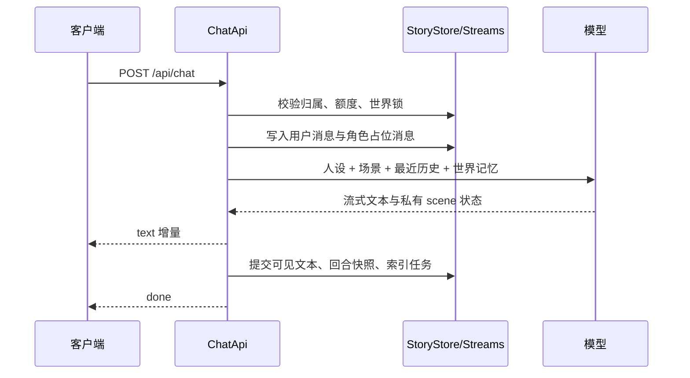

# 技术实现

本文描述 `apps/` 与 `packages/rp/` 的当前实现。未实现功能不列为现有能力，统一放入 TODO。

## 1. 桌面启动与模型包

`release-main.cjs` 根据发行 metadata 或开发环境选择 cloud/offline；两个版本使用不同 userData 名称。根目录开发入口额外指定 `.local/dev/`，与安装版隔离；未打包模式可注入本次构建的离线 JAR 与系统 Java，生产包固定使用内置运行时。窗口开启 sandbox、contextIsolation 与 webSecurity，不提供 Node 给页面。app 协议只允许读取发行目录内文件；IPC 校验主窗口、主 frame 和 app origin。新窗口与外部导航被拒绝。

离线 `OfflineRunner` 生成随机 bearer，分配四个回环端口，启动 Java API；模型包存在时还启动两个 llama-server 和冻结语音程序。Java 进程强制 offline profile 与 127.0.0.1。模型服务使用同一随机 API key。API 就绪后展示角色库，模型继续准备，状态与当前等待的服务名称由 bootstrap IPC 提供；子进程退出立即报告具体服务和重装/重新导入入口，不再等待完整超时。macOS 运行时包含动态加载的 ggml CPU、Metal、BLAS 插件，便携启动器固定使用包内后端，构建复用检查覆盖 native 可执行文件与插件。退出时停止本次子进程。

本机托管服务首次就绪后仍由 `LocalServiceSupervisor` 监视子进程 exit/error 及带认证的健康探测，分别报告 starting、ready、unhealthy、recovering、failed。只有确认死亡的聊天、嵌入或语音子进程才复用原端口、凭据及启动参数重启；仍存活但不健康的进程只降级报告，外部自有连接不由该监督器重启。自动恢复按 1/3/10 秒有限退避，连续最多三次，稳定健康六十秒后重置预算；手动“重试服务”只重试目标服务并合并并发请求，不重启正常模型或重载页面。端口被其它进程占用时明确失败，不结束占用者。后端退出可发现但不自动重启；关闭应用取消重试并忽略旧进程迟到事件。界面保留现有故事及输入状态，安全退出记录仅含固定服务类别、退出码/信号和时间，不写参数、令牌或模型输入。

内置嵌入服务使用单 slot（`--parallel 1`），上下文、physical batch 与 micro batch 均为 4096（`--ctx-size`、`--batch-size`、`--ubatch-size`）。嵌入输入必须按完整序列处理；不能沿用较小默认 batch 使长输入触发运行时断言，也不据短输入通过推断任意长度稳定。

模型包使用固定发行公钥验证 Ed25519 签名，逐文件核对大小与 SHA-256，拒绝越界路径和符号链接，再验证复制结果。包在临时目录安装；启动通过后提交，失败时恢复前一包。重启产生新端口后必须同步主进程的 API 基址。

缺少内置模型且未配置自有连接时，对话保留文字草稿并引导设置模型，照片仍可单独归档。模型导入从原生目录选择到服务重启、初始化和基址更新结束使用独立准备状态；期间设置关闭、Escape 和后台导航暂停，取消选择或失败后恢复操作，避免旧基址上的请求失败。

默认聊天模型为 Qwen3-4B 文本模型。图片仍可保存，但会明确告知不能识图。自定义连接目前按支持图像的请求格式发送附件，是否可用取决于服务能力，尚不自动探测；平台能力由 `STORY_LLM_VISION` 配置。

文字模型收到照片时，服务端直接确认保存并说明当前不能识别画面，不让未接收像素的模型猜测颜色或物体。支持图像的连接按“图片、用户问题”的顺序发送多模态内容，保留用户原问句。

侧栏和角色库提供“功能导览”，按使用情境直达场景、记忆、相册、语音、陪伴、日报、工具技能和备份设置；依赖已打开篇章的操作在未选择篇章时说明前提。聊天顶部显示当前剧情/现实陪伴模式，并可直接切换现实陪伴或打开主动搭话设置。自定义模型连接只替换聊天，记忆索引和语音仍需要各自的服务。

## 2. 聊天与流式提交

商业版用户端与管理端共用同一 Java 服务和身份库，管理端网页内嵌在商业 JAR 的 `/admin/`；它不是独立的第二套业务后端。

输入文本或音频使用同一入口。服务端先校验账号对角色、篇章和世界的所有权；不采信客户端提交的 userId。音频先经 ASR 转成用户文本。图片转换为带所有者的附件引用。

`Streams` 保证每用户、每世界同时只有一条生成流；云端总容量默认 20，离线为 1。回退、场景编辑等操作停止该世界的流后取得同一锁。中断、异常或连接断开时保留实际已生成的可见内容，状态标为 interrupted/failed；只有完整结束才应用私有场景更新。普通回复达到模型长度上限时保留已生成内容并标记 interrupted，消息上下文保存 completion.reason=length 与 incomplete=true，界面长期显示未完成提示和“继续回复”；点击后先填写续写草稿，保留原历史和未发送草稿，用户确认发送。模型返回空可见文本会失败，不提交虚假成功。

停止回复会等待服务端完成回合持久化（有界等待），随后刷新真实历史并恢复编辑、重试入口；超时会说明记录仍在保存，避免把空占位当成已保存回复。失败事件在失败状态落库后发出，并以 accepted 区分用户消息是否已持久化：尚未保存的发送恢复文字和照片草稿，已保存的模型失败通过原消息重试。编辑或重写图片消息会先读取签名图片链接并保留可重发字节，再执行可能删除原附件的回退；读图失败不修改历史。编辑、回退、重试使用应用内确认面板说明影响范围；主动来信使用“再次开场”，保留原来信。 同篇章回退成功后，消息和篇章刷新之外还重新读取会话状态，顶栏模式与暂停文案使用恢复后的状态；读取沿用篇章身份与请求版本保护，导航后的迟到结果不能覆盖新篇章。状态刷新失败会提示错误，不自动重做回退或重发。

可见回答的要求同时放在场景提示开头与本轮最终指令中，避免预算截断后模型只输出隐藏 scene。现实陪伴环境按中文背景字段提供，不以 JSON 暗示回复格式；没有可见内容仍明确失败，不伪造成功台词。

`RpOutputParser` 在分片边界过滤私有 scene 标签，`EmotionStream` 消费已知情绪开、闭标签；只有开标签触发表情，私有 JSON 与情绪标记不显示给用户。普通比较符、HTML 和未知标签保留。前端 `readSse` 处理跨字节 UTF-8、CRLF、注释、多行 data 和取消。会话/请求序号防止旧流回调写入新篇章。

当前聊天 SSE 包含 `asr`、`meta`、`text`、`emotion`、`search_status`、`sources`、`tool_status`、`warning`、`done`、`error`。桌面按句向同一业务后端请求 WAV，自动播放并通过 WebAudio 驱动 Live2D 口型；中断、切换篇章和退出均取消队列。商业桌面不直接连接 ASR/AstraTTS。

继续回复以`continuationHistoryId`绑定账号和篇章所属的原助手回复，读取原问题、已显示partial末尾最多700token及保存来源，补未完成任务；来源重读失败明确标注旧摘录非本轮核实，已选旧日报保留刊期。不自动重放旧图片像素。手动暂停且有正文时提供继续与重试两个动作，长度上限不重复入口；空白失败和已完成消息不开放手动继续。继续目标可取消，照片草稿、选刊及会话恢复按各自身份保存。模板真实事件只向重生成处理器传数值消息索引，独立继续事件不混入其参数。

普通对话每turn通过`currentBackground`承接当前用户明确声明，首次交流也保留有界背景；不以初见或缺旧记录否认本轮新设定。该约束不能保证模型所有任务或语言的语义遵循。空可见输出仍保存failed，并仅记录安全的finishReason/usage分类，不伪装成功。

## 3. 场景、分支与上下文预算

[阅读本节](implementation-state-and-services.md#3-场景分支与上下文预算)

## 4. 记忆索引

[阅读本节](implementation-state-and-services.md#4-记忆索引)

## 5. 认证、BYOK 与运营

[阅读本节](implementation-state-and-services.md#5-认证byok-与运营)

## 6. 附件、语音与数据导出

[阅读本节](implementation-state-and-services.md#6-附件语音与数据导出)

## 7. 主要 API

[阅读本节](implementation-api.md#7-主要-api)

## 8. SQL 访问、初始化与配置如何接起来

[阅读本节](implementation-api.md#8-sql-访问初始化与配置如何接起来)

## 陪伴、联网与主动能力

[阅读本节](implementation-companion.md#陪伴联网与主动能力)
